# MacBooth

맥에서 돌아가는 행사용 포토부스 앱입니다. 손님이 화면이나 아이패드 리모컨으로 촬영하면, 프레임에 합성된 사진이
클라우드에 올라가고 QR 코드로 휴대폰에서 바로 받을 수 있습니다.

[pibooth](https://github.com/pibooth/pibooth)(Raspberry Pi용, MIT)를 포크해 macOS 전용으로 정리했습니다.
Raspberry Pi 카메라(picamera2), GPIO 버튼/LED, Linux 자동시작은 빠졌습니다. 파이썬 패키지 이름과 설정 경로는
기존 플러그인·설정과 호환되도록 그대로 `pibooth`를 씁니다.

<p align="center">
  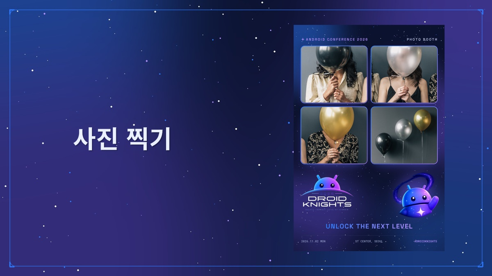
  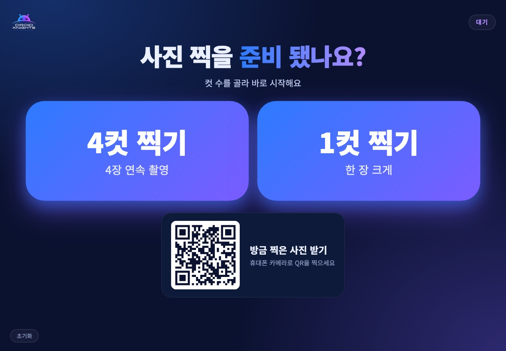
</p>

## 목차

- [기능](#기능)
- [설치와 실행](#설치와-실행)
- [부스 화면과 촬영 흐름](#부스-화면과-촬영-흐름)
- [관리 페이지](#관리-페이지) — 설정, 아이패드 리모컨, 사진 공장
- [사진 템플릿 만들기](#사진-템플릿-만들기) — 템플릿 스튜디오, 테마
- [디자인 바꾸기 (디자인 시스템 + Claude)](docs/DESIGN.md)
- [공유 페이지](#공유-페이지)
- [구조](#구조)
- [운영 배포](#운영-배포)
- [테스트](#테스트)

## 기능

- 맥 내장 카메라, iPhone 연속성 카메라, 웹캠(OpenCV), DSLR(gPhoto2) 촬영
- 1~4컷 촬영 후 프레임 템플릿으로 합성, 행사 테마(`pibooth/themes/droidknights`)
- 카운트다운 음성, 촬영 순간을 담은 짧은 영상 클립
- Cloudflare R2 업로드 + QR 공유 페이지(이메일로 링크 받기 포함)
- 웹 관리 페이지: 설정, 아이패드 리모컨, 대형 화면용 "사진 공장" 애니메이션
- 템플릿 스튜디오: 브라우저에서 프레임을 그리고 실제 엔진으로 미리보기
- CUPS 프린터 출력 (선택)

## 설치와 실행

```bash
python3 -m venv ~/pibooth-venv
~/pibooth-venv/bin/pip install -e ".[webcam,r2]"     # DSLR까지: ".[webcam,r2,dslr]"
~/pibooth-venv/bin/pibooth                            # 실행
```

- 처음 실행하면 `~/.config/pibooth/pibooth.cfg`(설정)와 `translations.cfg`(문구)가 만들어집니다.
- 행사용 플러그인은 `pibooth.cfg`의 `[GENERAL] plugins`에 경로를 적어 불러옵니다.

  ```ini
  [GENERAL]
  theme = droidknights
  language = ko
  # 한 줄로 적습니다 (줄바꿈하면 경로를 못 읽음)
  plugins = "~/macbooth/plugins/pibooth_picture_template.py", "~/macbooth/plugins/pibooth_r2_upload.py", "~/macbooth/plugins/pibooth_qrcode.py", "~/macbooth/plugins/pibooth_clip.py", "~/macbooth/plugins/pibooth_factory.py"
  ```

  빌드한 `MacBooth.app`은 이 플러그인들을 앱 안에 넣어 항상 불러오므로 따로 적지 않아도 됩니다.
- 설정 파일 편집: `pibooth --config` / 기본값으로 초기화: `pibooth --reset`

**조작**

| 동작 | 키보드 / 마우스 |
|---|---|
| 촬영 | `P` 또는 화면 왼쪽 클릭 |
| 출력 | `Ctrl+E` 또는 화면 오른쪽 클릭 |
| 설정 메뉴 | `Esc` (터치스크린: 네 손가락) |
| 전체 화면 | `Ctrl+F` |

## 부스 화면과 촬영 흐름

| 대기 | 컷 수 선택 |
|---|---|
|  | 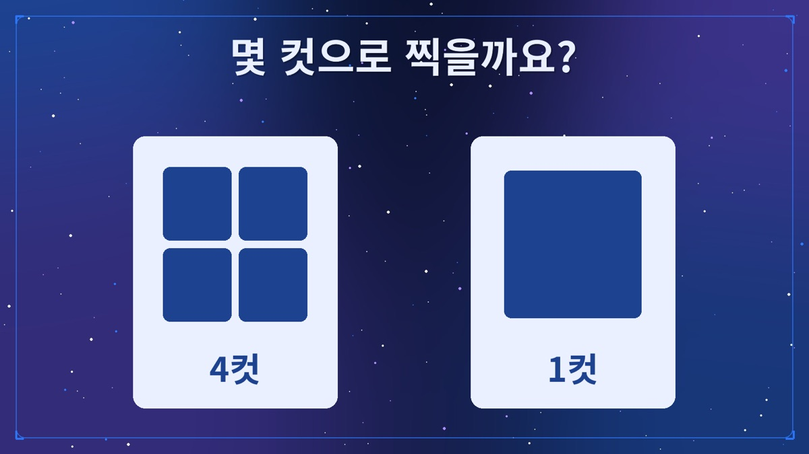 |
| **프레임 선택** | **사진 만드는 중** |
| 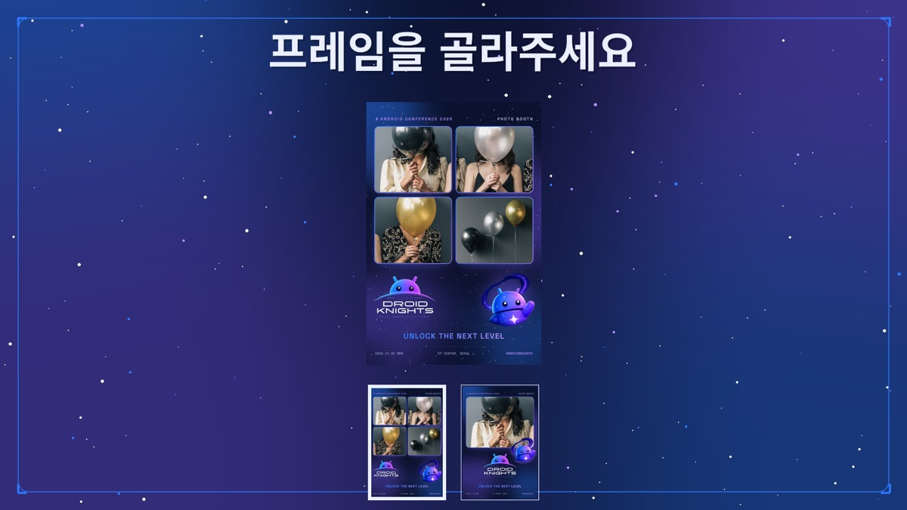 | 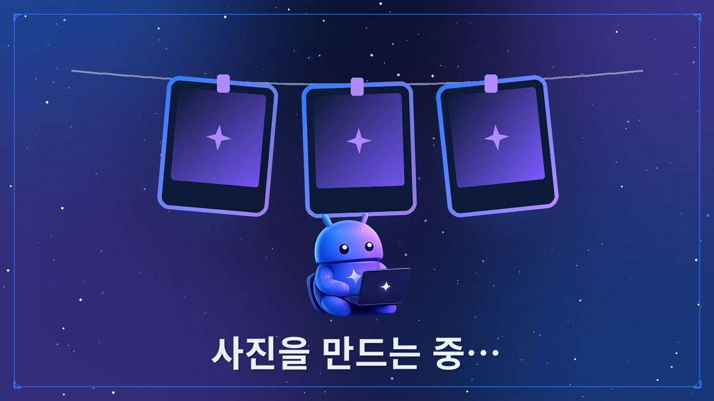 |

```
wait ──촬영──▶ choose(컷 수) ─▶ chosen ─▶ preview(카운트다운) ─▶ capture ─┐
  ▲                                       ▲                              │ 남은 컷
  │                                       └──────────────────────────────┘
  └── finish ◀── print ◀── processing(합성) ◀── layout(프레임 선택)
```

- 컷 수를 하나만 켜면 `choose`를 건너뜁니다. 프레임이 하나뿐이거나 고정 프레임을 정하면 `layout`을 건너뜁니다.
- 프린터가 없으면 `print` 없이 `finish`로 갑니다.
- 대기 화면에는 방금 찍은 사진과 그 사진을 받을 수 있는 QR 코드가 나옵니다.

완성된 사진 예시 (4컷 / 1컷, 2400×3600 px):

<p align="center">
  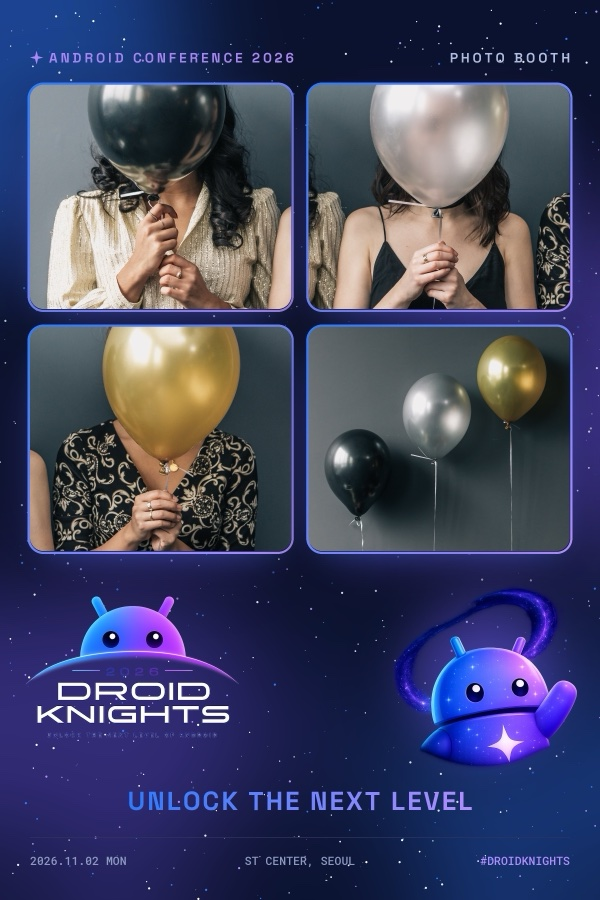
  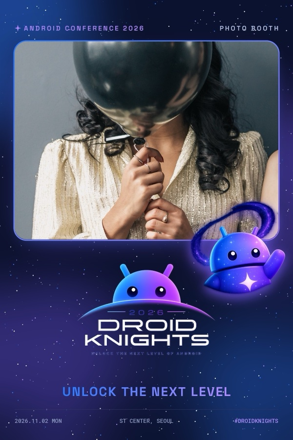
</p>

## 관리 페이지

부스를 켜면 `pibooth_factory` 플러그인이 맥에서 작은 웹 서버(기본 `http://localhost:8770`)를 띄웁니다.

| 페이지 | 주소 | 누가 쓰나 |
|---|---|---|
| 설정 | `/settings` | 운영자 (맥 또는 같은 네트워크의 기기) |
| 아이패드 리모컨 | `/remote` | 손님 (부스 옆 아이패드) |
| 사진 공장 | `/` | 대형 화면에 띄워 두는 연출용 |

기본은 **이 맥에서만** 열립니다. 아이패드에서 쓰려면 설정의 **접속 허용**을 `같은 네트워크`로 바꾸고 PIN을 정한 뒤
부스를 재시작하세요. 네트워크 설정, 방화벽, 문제 해결은 [factory/README.md](factory/README.md)에 있습니다.

### 설정 (`/settings`)

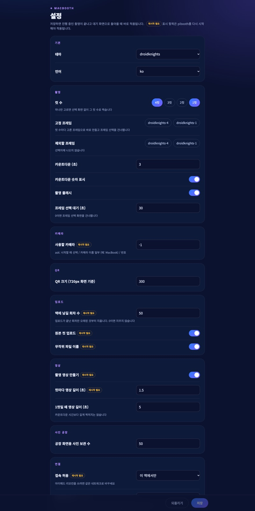

자주 바꾸는 옵션을 브라우저에서 바꿉니다. **저장**하면 `pibooth.cfg`에 기록되고, 진행 중인 촬영이 끝나 대기
화면으로 돌아갈 때 적용됩니다. `재시작 필요` 표시가 붙은 항목은 부스를 다시 켜야 적용됩니다.

| 묶음 | 항목 | 설명 |
|---|---|---|
| 기본 | 테마, 언어 | 화면 문구·색·프레임 묶음 |
| 촬영 | 컷 수 | 손님에게 보여줄 컷 수(1~4). 하나만 켜면 선택 화면 없이 촬영 |
| | 고정 프레임 | 컷 수마다 이 프레임으로 바로 합성(프레임 선택 생략) |
| | 제외할 프레임 | 선택지에서 숨길 프레임 |
| | 카운트다운, 숫자 표시, 플래시 | 촬영 직전 연출 |
| | 프레임 선택 대기 | 이 시간이 지나면 선택된 프레임으로 진행. 0이면 선택 화면 생략 |
| 카메라 | 사용할 카메라 | `ask`(시작할 때 고르기), 이름 일부(`MacBook`, `iPhone`), 번호 |
| QR | QR 크기 | 대기 화면 QR 크기 |
| 업로드 | 맥에 남길 회차 수 | 업로드가 끝난 회차만 오래된 것부터 지움 |
| | 원본 컷 업로드, 무작위 파일 이름 | 무작위 이름은 링크를 추측할 수 없게 함 |
| 영상 | 촬영 영상 만들기, 영상 길이 | 촬영 직전 몇 초를 MP4로 저장해 함께 업로드 |
| 사진 공장 | 보관 수 | 공장 화면에 쓰는 사진 수 |
| 연결 | 접속 허용, 설정 화면 PIN | 아이패드 리모컨을 쓰려면 `같은 네트워크` + PIN |

그 밖의 옵션은 `pibooth --config`로 파일을 직접 고치거나 부스 화면에서 `Esc` 메뉴를 씁니다.

<br clear="right">

### 아이패드 리모컨 (`/remote`)

| 대기: 컷 수 고르고 바로 촬영 | 프레임 선택 |
|---|---|
|  | 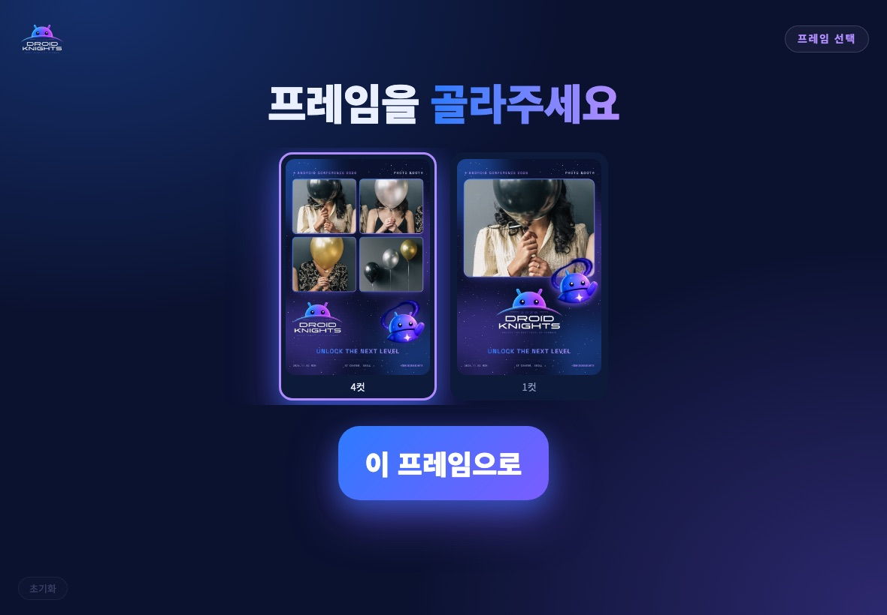 |

- 손님이 아이패드에서 컷 수를 누르면 바로 촬영이 시작되고, 합성 단계에서는 프레임을 고릅니다.
- 촬영이 끝나면 **방금 찍은 사진 받기** QR이 나옵니다.
- 왼쪽 아래 **초기화**는 대기 화면의 이전 사진을 지웁니다.
- 부스 상태(대기/촬영 중/프레임 선택…)를 따라 버튼이 켜지고 꺼지며, 촬영 중에는 눌리지 않습니다.
- Safari에서 **공유 → 홈 화면에 추가**로 앱처럼 전체 화면으로 쓰는 것을 권장합니다.

### 사진 공장 (`/`)

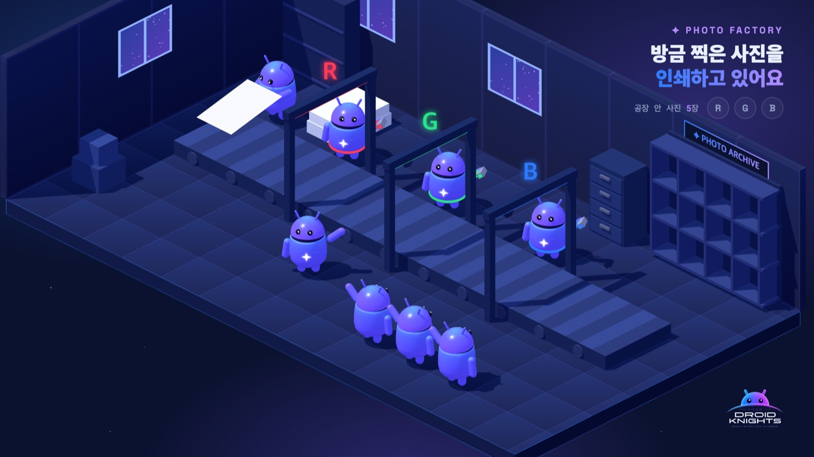

새 사진이 찍힐 때마다 3D 공장 라인에서 R·G·B 색을 입혀 "인쇄"되는 애니메이션입니다. 부스 옆 대형 TV나 모니터에
전체 화면으로 띄워 둡니다. 사진은 맥 디스크에서 바로 읽으므로 인터넷이 없어도 동작합니다.
부스 없이 `python3 -m http.server 8780 -d factory`로 띄워 열면 샘플 사진으로 데모가 돌아갑니다.

## 사진 템플릿 만들기

최종 사진의 배치(사진 칸, 배경, 로고, 문구)는 **템플릿** JSON 파일이 정합니다.
템플릿을 만드는 방법은 두 가지입니다.

| 방법 | 언제 쓰나 |
|---|---|
| 템플릿 스튜디오(`admin/`) | 손으로 칸을 배치해 프레임을 하나씩 만들 때 |
| 테마 빌드(`tools/build_theme.py`) | 색·폰트·로고 같은 행사 디자인 토큰에서 4컷·1컷 프레임과 부스 화면 이미지를 한 번에 만들 때 |

### 템플릿 스튜디오

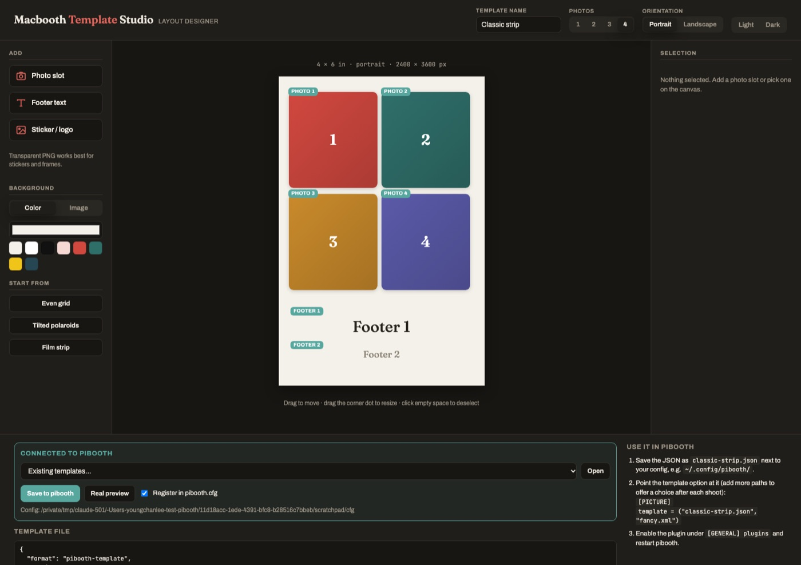

```bash
admin/run.sh                 # http://localhost:8080 이 열림 (--port, --config, --no-browser)
```

1. 위쪽에서 **템플릿 이름**, **컷 수(1~4)**, **세로/가로**를 정합니다.
2. 왼쪽 **Start from**에서 시작 배치(Even grid, Tilted polaroids, Film strip)를 고르거나,
   **Photo slot / Footer text / Sticker·logo**로 칸을 직접 추가합니다.
3. 캔버스에서 칸을 끌어 옮기고, 모서리 점으로 크기를 바꿉니다. 오른쪽 **Selection**에서 회전, 둥근 모서리,
   원형 마스크 같은 세부 값을 고칩니다.
4. **Background**에서 배경색이나 배경 이미지를 정합니다. 투명 PNG는 프레임·스티커로 쓰기 좋습니다.
5. 아래 **Connected to pibooth** 패널에서
   - **Real preview**: 실제 부스 합성 엔진으로 번호 붙은 샘플 사진을 넣어 결과를 미리 봅니다.
   - **Save to pibooth**: `~/.config/pibooth/<이름>.json`으로 저장합니다.
     **Register in pibooth.cfg**를 켜 두면 `[PICTURE] template`과 템플릿 플러그인도 설정에 추가합니다.
   - **Existing templates… → Open**: 저장된 템플릿을 다시 불러와 고칩니다.
6. 부스를 재시작하면 프레임 선택 화면에 새 프레임이 나옵니다.

> **테마를 쓰는 중이라면:** 테마(`theme.json`)에 `templates`가 있으면 그 프레임이 `pibooth.cfg`의
> `[PICTURE] template`보다 우선합니다. 스튜디오에서 만든 프레임을 쓰려면 설정에서 테마를 비우거나,
> 만든 JSON을 테마의 `templates/` 폴더에 넣고 `theme.json`의 `templates` 목록에 추가하세요.

템플릿 형식(좌표는 0~1 비율이라 어떤 해상도에서도 같은 배치로 그려짐):

```json
{
  "format": "pibooth-template", "version": 1, "name": "Classic strip",
  "captures": 4, "orientation": "portrait",
  "background": {"color": [255, 255, 255]},
  "slots": [
    {"type": "capture", "index": 1, "rect": [0.05, 0.05, 0.43, 0.30], "mask": "rounded", "radius": 0.04},
    {"type": "text", "index": 1, "rect": [0.05, 0.85, 0.90, 0.06], "align": "center"},
    {"type": "image", "src": "data:image/png;base64,...", "rect": [0.70, 0.88, 0.25, 0.10]}
  ]
}
```

자세한 키 설명은 `plugins/pibooth_picture_template.py`의 `JsonTemplate` 클래스에 있습니다.
출력 크기는 세로 2400×3600, 가로 3600×2400 px(4×6인치, 인쇄 품질)입니다.

### 테마

테마는 행사 하나의 디자인 묶음입니다. 폴더 하나에 `theme.json`과 폰트, 이미지, 프레임이 들어 있습니다.

```
pibooth/themes/droidknights/
├─ theme.json        색, 폰트, 이미지 이름, 화면 문구, 행사 정보, 공유 페이지 문구, 프레임 목록
├─ fonts/            테마 전용 폰트
├─ assets/           로고, 마스코트, 부스 배경, 화면 일러스트
└─ templates/        droidknights-4.json, droidknights-1.json (빌드로 생성)
```

| `theme.json` 키 | 용도 |
|---|---|
| `colors`, `gradients`, `fonts` | 디자인 토큰. 다른 키에서 이름으로 참조 |
| `booth` | 부스 화면 배경, 글자색, 폰트 |
| `texts.ko`, `texts.en` | 부스 화면 문구 (`사진 찍기`, `몇 컷으로 찍을까요?` …) |
| `event` | 프레임에 들어가는 행사 이름, 날짜, 장소, 해시태그 |
| `qrcode`, `clip` | QR 색, 영상 워터마크 위치 |
| `share` | 공유 페이지와 메일 문구 |
| `templates` | 이 테마가 쓰는 프레임 목록 |

새 행사 테마를 만드는 순서:

1. `pibooth/themes/droidknights`를 복사해 이름을 바꿉니다. `~/.config/pibooth/themes/<이름>/`에 두어도 됩니다.
2. `theme.json`의 색, 폰트, `event`, 문구를 바꾸고 `assets/`의 로고·마스코트 이미지를 교체합니다.
3. 프레임과 화면 이미지, 공유 페이지 테마를 생성합니다.

   ```bash
   ~/pibooth-venv/bin/python tools/build_theme.py <이름> --worker share-worker/src/theme.js
   ```

4. 설정 페이지에서 테마를 고르거나 `[GENERAL] theme = <이름>`으로 정하고, 공유 페이지도 다시 배포합니다.

디자인 시스템과 Claude로 색·폰트·프레임·화면을 바꾸는 자세한 방법은 **[docs/DESIGN.md](docs/DESIGN.md)**에 있습니다.

## 공유 페이지

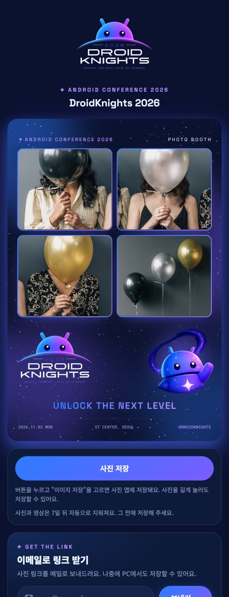

손님이 QR을 찍으면 열리는 휴대폰용 페이지입니다(`share-worker/`, Cloudflare Worker).

- 사진(과 영상)을 보고 **사진 저장**으로 휴대폰에 저장합니다.
- **이메일로 링크 받기**: 주소를 넣으면 링크를 메일로 보냅니다(Amazon SES, Resend, Brevo 중 하나).
  주소는 보내는 데만 쓰고 저장하지 않습니다.
- 사진은 부스가 올린 R2 버킷에서 바로 읽으므로 버킷을 공개할 필요가 없습니다.
- 업로드가 아직 안 끝난 사진은 "준비 중" 화면을 보여주고 자동으로 다시 확인합니다.

**배포:** `share-worker/wrangler.example.toml`은 예시 값만 든 템플릿입니다. 실제 서비스 전에 복사해서
도메인, R2 버킷, 발신 이메일을 바꾼 뒤 배포하세요. `wrangler.toml`은 git에 올라가지 않고,
예시 값이 남아 있으면 `npm run deploy`가 배포를 막습니다.

```bash
cd share-worker
cp wrangler.example.toml wrangler.toml   # 값 수정
npx wrangler secret put RESEND_API_KEY   # 메일 서비스 키 (SES면 AWS_ACCESS_KEY_ID / AWS_SECRET_ACCESS_KEY)
npm run deploy
```

부스 쪽에서는 `pibooth.cfg`의 QR 주소를 이 도메인으로 맞춥니다(`[QRCODE] prefix_url = https://<도메인>/p/{key}`).
자세한 내용은 [share-worker/README.md](share-worker/README.md).

<br clear="right">

## 구조

```
pibooth/              앱 본체 (패키지 이름은 원본 호환을 위해 pibooth 유지)
├─ booth.py           진입점, 메인 루프, 키보드/마우스/터치 이벤트
├─ states.py          상태 머신
├─ camera/            opencv.py(웹캠·내장·iPhone), gphoto.py(DSLR), hybrid.py(미리보기 웹캠 + 촬영 DSLR)
├─ plugins/           기본 플러그인: 카메라, 사진 합성, 화면, 프린터 + hookspecs.py(훅 정의)
├─ view/              pygame 화면 그리기
├─ config/            pibooth.cfg 기본값(parser.py)과 Esc 설정 메뉴(menu.py)
├─ themes/droidknights/  테마
└─ sounds.py, language.py, printer.py, counters.py
plugins/              행사용 플러그인
├─ pibooth_picture_template.py  템플릿으로 최종 사진 합성, 프레임 선택
├─ pibooth_clip.py              촬영 직전 몇 초를 MP4로 저장
├─ pibooth_r2_upload.py         사진/영상을 Cloudflare R2에 업로드 (끊기면 백그라운드 재시도)
├─ pibooth_qrcode.py            대기 화면에 공유 페이지 QR 표시
└─ pibooth_factory.py           관리 페이지 웹 서버(:8770): 설정, 리모컨, 사진 공장
factory/              관리 페이지 HTML
share-worker/         공유 페이지 (Cloudflare Worker)
admin/                템플릿 스튜디오 (로컬 서버 + 편집기)
tools/                build_theme.py(테마 빌드), preview_theme.py(테마 미리보기), template_editor.html(템플릿 스튜디오 화면)
packaging/            PyInstaller로 MacBooth.app 빌드
docs/images/          README 이미지
tests/                pytest
```

각 상태에서 `pibooth_*` 훅이 호출되고, 기본 플러그인과 `plugins/`의 플러그인이 이 훅을 구현합니다
(훅 목록: `pibooth/plugins/hookspecs.py`).

**사진이 손님에게 가는 경로**

```
카메라 ─▶ 합성(picture_template) ─▶ ~/Pictures/pibooth 저장
                                    ├─▶ R2 업로드(r2_upload) ─▶ 공유 페이지(share-worker) ◀─ QR(qrcode)
                                    ├─▶ 사진 공장 화면(factory)
                                    └─▶ 프린터(CUPS, 선택)
```

**설정**은 `~/.config/pibooth/pibooth.cfg` 하나로 관리합니다. `Esc` 메뉴, 설정 페이지, 파일 직접 편집 중
어느 방법으로 바꿔도 같은 파일에 저장됩니다.

## 운영 배포

### 1. 공유 페이지 (처음 한 번)

R2 버킷을 만들고 `share-worker`를 배포합니다. [공유 페이지](#공유-페이지) 참고.

### 2. 앱 빌드

설정을 다 맞춘 맥에서 빌드합니다. 그 맥의 `pibooth.cfg`와 템플릿이 앱 안에 함께 들어갑니다.

```bash
packaging/build_mac.sh          # → dist/MacBooth.app, dist/MacBooth.zip
```

- **R2 키 같은 비밀 값도 앱에 들어갑니다.** zip은 믿을 수 있는 사람에게만 전달하세요.
  키를 앱에 넣지 않으려면 `pibooth.cfg`에서 빼고 `PIBOOTH_R2_ACCESS_KEY_ID`, `PIBOOTH_R2_SECRET_ACCESS_KEY` 환경 변수로 넘깁니다.
- Apple Silicon 전용입니다. 자세한 내용은 [packaging/README.md](packaging/README.md).

### 3. 행사장 맥에 설치

1. `MacBooth.zip`을 풀어 `/Applications`에 넣습니다.
2. 처음 실행할 때 **우클릭 → 열기**로 엽니다. 카메라 권한은 **허용**을 누릅니다.
   그래도 안 열리면 `xattr -dr com.apple.quarantine /Applications/MacBooth.app`.
3. `~/.config/pibooth/pibooth.cfg`가 없으면 빌드한 맥의 설정이 복사됩니다. 이미 있으면 그대로 둡니다.

### 4. 행사 당일 체크리스트

- [ ] 카메라 연결, 테스트 촬영 1회
- [ ] 아이패드 리모컨: 설정에서 접속 허용을 `같은 네트워크`로 바꾸고 PIN 설정 → 앱 재시작
- [ ] 휴대폰으로 QR 스캔 → 공유 페이지에서 사진이 열리는지 확인
- [ ] 게스트 와이파이는 기기끼리 통신을 막는 경우가 많으니 소형 공유기나 핫스팟 준비
- [ ] 대형 화면에 사진 공장(`/`) 전체 화면으로 띄우기
- [ ] 프린터를 쓰면 시험 출력 1장

인터넷이 끊겨도 촬영, 리모컨, 사진 공장은 계속 동작합니다. 업로드되지 않은 사진은 네트워크가 돌아오면 같은 링크로
다시 올라가서, 이미 나눠준 QR도 그대로 쓸 수 있습니다.

## 테스트

```bash
SDL_VIDEODRIVER=dummy CAM_VIDEODRIVER=dummy ~/pibooth-venv/bin/python -m pytest tests admin
cd share-worker && npm test
```

## 라이선스

MIT. 원본 pibooth 저작권 표시는 [LICENSE](LICENSE)에 있습니다.
README의 사진 예시는 원본 pibooth 테스트 이미지(`tests/captures`)로 만들었습니다.
